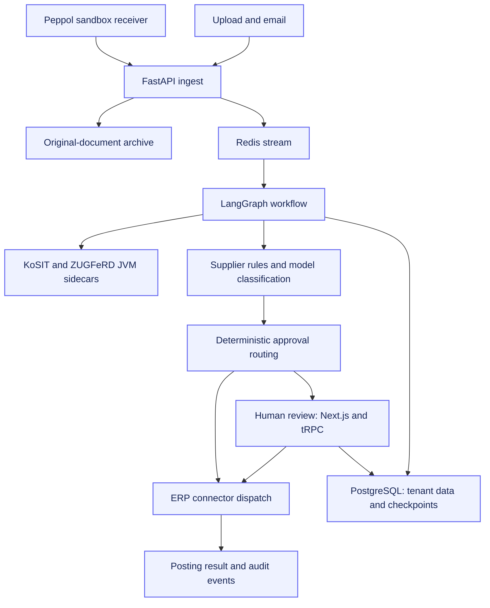

# RechnungsRadar

**Engineering case study: from structured invoice to reviewed ERP posting.**

Next.js · TypeScript · FastAPI · LangGraph · PostgreSQL · JVM sidecars

[Problem](#the-problem) · [Workflow](#the-workflow) · [Architecture](#architecture) · [Decisions](#engineering-decisions) · [Scope](#implementation-and-validation-scope)

## At a glance

| | |
| --- | --- |
| Product | E-invoice processing and accounts-payable automation for German SMEs |
| Author | [Ayham Joumran](https://github.com/AyhamJo7) |
| Engineering scope | Full-stack application, workflow orchestration, data isolation, integrations and operational tooling |
| Inputs | XRechnung UBL/CII and ZUGFeRD hybrid PDFs |
| Human control | Review, correction and approval before posting when routing requires it |
| Source availability | Commercial implementation remains private; this document is a public-facing case study |
| Evidence scope | Describes implementation; no independently measured customer savings or compliance certification claimed |

## The problem

Receiving an electronic invoice is only the first step. A business must extract its
financial fields, validate the format, propose accounting mappings, resolve
exceptions, obtain approval where required, and transfer the result to an ERP.
The original document and the decisions made along the way must remain traceable.

RechnungsRadar brings these steps into a single workflow with an exception lane and
a review interface. Its design keeps financial extraction deterministic, limits
model use to classification, and makes external posting an explicit boundary.

## The workflow

1. **Receive and preserve.** Upload, email or a sandbox Peppol receiver hands off
   the invoice. The untouched original is archived before processing.
2. **Normalize and validate.** UBL and CII adapters produce a shared invoice model;
   JVM sidecars handle ZUGFeRD extraction and KoSIT validation.
3. **Propose a mapping.** Supplier rules take precedence. Model-assisted
   classification handles cases without an applicable matured rule.
4. **Review where required.** Deterministic routing decides whether to pause.
   An operator can inspect findings, correct mappings, approve or reject.
5. **Post and record.** An ERP connector handles dispatch and records its result.
   Audit events link the decisions; durable workflow state supports resumption.

## Architecture

The diagram summarizes responsibilities rather than every network connection.
Application services use Python; the review surface uses React/TypeScript. Thin
Java services reuse established invoice libraries. PostgreSQL holds business state
and workflow checkpoints; Redis carries document events.

## Engineering decisions

| Decision | Reason | Trade-off |
| --- | --- | --- |
| A canonical model keyed on EN 16931 business terms | Keep downstream logic independent of UBL/CII syntax | Adapters and format fixtures need deliberate maintenance |
| Deterministic financial parsing | Amounts and tax fields must come from the document | Unstructured PDFs need a separate capture/manual-entry path |
| Supplier rules before model classification | Reuse known mappings and reserve inference for unmatched cases | Rule maturity and correction feedback require explicit handling |
| Durable human-review interrupt | Approval must survive worker restarts | Resume behavior and authorization become part of the workflow contract |
| PostgreSQL FORCE RLS | Enforce tenant isolation at the database boundary | Every transaction and checkpoint must carry the tenant context |
| JVM libraries behind HTTP boundaries | Reuse KoSIT and mustangproject | More service boundaries to operate and test |
| Append-only hash-linked audit events | Make decision history and tampering detectable | A hash chain alone does not establish legal compliance |
| Connector-specific idempotency | Reduce duplicate posting during retries | External systems still require reconciliation and integration testing |

## User experience

The review application combines an invoice inbox, document detail, editable mapping,
validation findings and audit history. Approve, correct and reject actions resume
the same underlying workflow. Session membership determines the available tenant;
a workspace selector cannot grant access to an unrelated tenant.

A tenant dashboard exposes processing outcomes and durations. Hours-saved figures
are estimates from the product's telemetry model, not independently measured
customer outcomes. Cross-tenant reporting uses a separate restricted analytics
role and aggregates PII-free facts.

## Reliability and security

The implementation includes hardened XML parsing, bounded upload handling,
tenant-scoped data access, idempotent dispatch, structured logs and operational
metrics. The archive uses an Object Lock design, while audit exports retain the
original artifacts and event history.

These are engineering mechanisms supporting auditability. Legal compliance depends
on deployment, retention policy, operating procedures and professional review;
this case study makes no blanket GoBD, GDPR or production-readiness claim.

## Implementation and validation scope

| Area | Current scope |
| --- | --- |
| Structured-invoice processing | Parsing, validation, classification, review, archive and connector paths implemented |
| Review interface | Next.js, tRPC and Auth.js application with membership-bound tenant selection |
| Connectors | Lexware Office, DATEV and SAP Business One implementations; live account/partner validation remains a separate gate |
| Peppol | Sandbox receive/handoff path; production access-point provisioning is separate |
| Plain PDFs | Backend manual-entry path documented; the corresponding web entry form remains unfinished in the current project guidance |
| Tests | Format fixtures, workflow tests, database-isolation tests and frontend tests exist; no fresh full-suite result is asserted here |
| Commercial operation | Current workspace guidance records Stripe test mode; this is not evidence of paying-customer operation |
| Impact | No invented transaction volume, accuracy, time savings or customer adoption figures |

## A focused demonstration

A useful demo uses a synthetic structured invoice and follows four visible steps:
validation findings → proposed mapping → human correction/approval → posting result
and audit history. A local test connector must be labelled as simulated; production
ERP access should only be claimed after a real authorized integration run.

This demonstrates how product UX, asynchronous orchestration and relational data
controls fit together around one business task.

## Rights

**All rights reserved.** This case study is provided for portfolio inspection.
Reuse, adaptation and redistribution require written permission, subject to
GitHub platform rights and applicable law. See [LICENSE](LICENSE).

## Contact

Built by [Ayham Joumran](https://github.com/AyhamJo7).
See [iquantum.co](https://iquantum.co) for the wider portfolio.

This showcase contains documentation only. It does not distribute the commercial
application, tenant data, credentials or production configuration.
